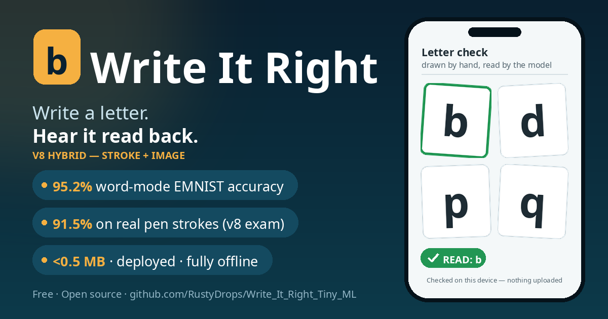

# Write It Right — Tiny ML



A tiny handwriting-letter recognizer (the v8 hybrid deploys in 296,637 bytes —
under 0.5 MB — and runs fully offline, in a browser or on
a microcontroller-class device) built to check the letters young writers mix
up most: **b, d, p, q**. No AI-generated labels and no frontier-model output
in any training data; v2 is trained only on public-domain data, and v8's
stroke data is openly licensed (see the v8 section). See PROVENANCE.md.

## v2 results (full official EMNIST byclass test, 116,323 samples)

| Metric | v1 | v2 |
|---|---|---|
| Raw 62-class accuracy | 76.5% | **85.5%** |
| Word-mode accuracy (letters only, case-merged) | — | **95.2%** |
| Word-mode b / d / p / q | 89.8 / 94.9 / 72.8 / 40.4% (raw) | **96.5 / 98.3 / 98.3 / 90.8%** |

Word-mode is the product metric: when a child writes a word, digits are not
candidate answers and letter case doesn't matter. v1's scary-looking p and q
scores were mostly mode artifacts (p predicted as capital P; q predicted as
the digit 9).

- Model: 248,958-param CNN, trained on the full EMNIST byclass train split
  (697,932 samples, 10 epochs)
- int8 ONNX: 259,143 bytes; quantization cost ≈ 0 (paired 10k check:
  word-mode 94.91% int8 vs 94.77% fp32)
- Data: EMNIST (NIST Special Database 19) — public domain

## v8 — stroke-primary hybrid (2026-11-19)

v8 pairs the frozen v2 image model with a tiny **stroke engine** — a
27,194-param network that reads the pen-point stream itself (12 points ×
x, y, dx, dy, pen-lift), not the finished ink. Routing is one rule:

- **Pen points present** (the normal case — the writing surface captures
  strokes natively): the stroke engine decides.
- **Image only:** v8 calls the frozen v2 keeper directly, and its output
  is *exactly* v2's (verified 100% agreement on the exam, plus a
  degenerate-input probe: empty or single-point streams fall back too).

Why strokes: a single-story **a** and a **q** end as similar ink but are
*built* differently, and the stroke model sees the building. On the v8
exam, the image model's signature failure — reading **a** as **q** —
drops from 7.35% to **0.00%**.

### v8 exam results (1,768 samples, 17 UJI writers in neither component's training pool)

| Metric (exam) | Keeper v2 (image) | Hybrid, first stroke engine | **Hybrid, H1 stroke engine (current)** |
|---|---|---|---|
| Overall accuracy | 82.92% | 86.71% | **91.52%** |
| a→q | 7.35% | 0.00% | **0.00%** |
| a/q combined error | 23.53% | 12.50% | **8.82%** |
| e/f combined error | 28.68% | 11.76% | **7.35%** |
| n/h combined error | 24.26% | 25.00% | **11.03%** |
| Combined pair sum | 0.7647 | 0.4926 | **0.2721** |

The original v8 passed all 5 pre-registered keeper gates with the first
stroke engine. The **H1 engine** (adopted 2026-11-19 after re-scoring on
the same exam — see `hybrid-v8/ADOPTION-H1.md`) raised the hybrid to
91.52% with every problem pair improved. Deployed size: **296,637 bytes**
int8 estimate (v2 int8 259,143 B + stroke engine ≈27 KB + routing code).

### v8 data and licenses

- Image model (v2): EMNIST (NIST Special Database 19) — public domain.
- Stroke engine (H1): UJIpenchars2 (UCI ML Repository, **CC BY 4.0**,
  Llorens et al., LREC 2008) + Character Trajectories (UCI dataset 175,
  **CC BY 4.0**) + HWRT isolated letters (Zenodo record
  10.5281/zenodo.50022, **ODbL 1.0** — database by Martin Thoma
  (write-math.com); ~90% of the recordings were collected by Daniel
  Kirsch's Detexify project and republished in HWRT; see
  `stroke-data-hunt/SOURCES.md` for the exact source terms and the
  project's ODbL note).
  No frontier-model output in any training data, labels, or selection.

### v8 caveats — read before quoting the numbers

- The exam writers were **never trained on** by either component, but
  they *were evaluated in earlier project splits* — this is a
  writer-disjoint result, **not virgin data**.
- **v2 remains the image-only keeper.** Its 95.24% EMNIST word-mode
  figure is untouched and is the right number for image-only input;
  91.52% is the stroke-present number on unseen UJI writers.
- All training/eval handwriting is **adult** handwriting. Neither v2 nor
  v8 has been validated on children's handwriting; a kids'-handwriting
  evaluation is required before grading real children's work.

## How this compares

Published reference points for the image model's task, EMNIST Letters:

- The dataset's original benchmark (Cohen et al. 2017,
  [arXiv:1702.05373](https://arxiv.org/pdf/1702.05373)) reports **85.15%**
  as its best Letters result.
- A recent purpose-built CNN (CSA-CNN, *Mathematics* 2023,
  [paper](https://mdpi-res.com/d_attachment/mathematics/mathematics-11-01141/article_deploy/mathematics-11-01141.pdf?version=1677251119))
  reports **93.95%** test accuracy on EMNIST Letters at ~242k parameters.
- This project's image model (v2, 248,958 params) scores **95.24% word-mode**
  on the full official EMNIST test — above those ranges, with an explicit
  caveat: word-mode is letters only with case merged (digits excluded as
  candidate answers), an easier protocol than the standard 26/62-class
  splits, so this is **not** a like-for-like state-of-the-art claim.

The stroke engine has no comparable leaderboard: it is scored on real pen
data (UJI / Character Trajectories-style exams), for which there is no
standard public benchmark. Its exam numbers are reported in the v8 section
above with their protocols, and the full per-letter results are in
`hybrid-v8/results_v8_h1.json`.

## Use it yourself

There is no browser demo in this repo — what ships is the model, the
evaluation code of record, and the routing/featurization code, all usable
directly:

### Image mode (the v2 ONNX model)

`write_it_right_v2_int8.onnx` (259,143 B) runs with
[onnxruntime](https://onnxruntime.ai/) anywhere. Input is one tensor named
`input`, shape `(N, 1, 28, 28)`, float32, white-on-black, pixels scaled to
0–1. EMNIST-style images are stored transposed; transpose to upright first
(the eval scripts in this repo do `np.transpose(X, (0, 2, 1))`). Output is
62 logits in the order given by `labels.json` (0–9, A–Z, a–z):

```python
import json
import numpy as np
import onnxruntime as ort

labels = json.load(open("labels.json"))  # 62 classes
sess = ort.InferenceSession("write_it_right_v2_int8.onnx",
                            providers=["CPUExecutionProvider"])
x = np.zeros((1, 1, 28, 28), dtype=np.float32)  # your letter image, /255
logits = sess.run(None, {"input": x})[0]
print(labels[int(logits.argmax(1)[0])])  # raw 62-class answer
```

For the product's word-mode answer (letters only, case doesn't matter),
restrict the logits to the letter classes (indices 10–61) and merge case:

```python
letter_idx = np.array(list(range(10, 62)))
cls = int(letter_idx[logits[:, letter_idx].argmax(1)[0]])
letter = "abcdefghijklmnopqrstuvwxyz"[(cls - 10) % 26]
```

### Stroke mode (the v8 hybrid)

If your writing surface captures pen points, prefer the stroke path — it
is the v8 hybrid's primary mode (91.52% on the v8 exam, a→q = 0.00%):

- Featurize a stroke stream (a list of strokes, each a list of (x, y)
  pen points) with `featurize(strokes, npts=12)` from `stroke/common.py`
  — 12 points × (x, y, dx, dy, pen-lift).
- Run the `StrokeNet` class from `stroke/train_stroke.py` with the H1
  weights in `hybrid-v8/stroke_engine_h1_model.pt`; its output is a
  26-way letter prediction.
- Routing rule (the hybrid's only rule, implemented in
  `hybrid-v8/eval_v8_h1.py`): a sample with a real pen stream (any stroke
  of ≥2 points) is decided by the stroke engine; anything else — image
  only, empty, or single-point streams — falls back to the v2 image
  model above, whose output it reproduces exactly.

The eval scripts (`hybrid-v8/eval_v8.py`, `hybrid-v8/eval_v8_h1.py`) are
the code of record for the v8 numbers; the exam sample data itself is not
redistributed (see PROVENANCE.md for each corpus's terms).

## Honest limits

EMNIST is **adult** handwriting. This model has not been validated on
children's handwriting; a kids'-handwriting evaluation is required before
using it to grade real children's work. q remains the weakest letter.

## Files

- `train_full.py` — the v2 training script (resumable checkpoints)
- `results_v2.json` / `results.json` — full metrics for v2 / v1
- `onnx_eval_v2_subset.json` — int8-vs-fp32 paired evaluation
- `PROVENANCE.md` — data sources, licenses, and method (v1–v8, incl. the
  v8 pre-registration, results, and the H1 engine-swap record)
- `write_it_right_v2_int8.onnx` — the v2 int8 model binary (259,143 B),
  included since the v8 release so the hybrid is runnable from this repo
- `hybrid-v8/` — v8 routing + evaluation code of record (`eval_v8.py`,
  `eval_v8_h1.py`), both exam result files, the H1 adoption record, and
  the H1 stroke engine (`stroke_engine_h1_model.pt`)
- `stroke/` — stroke featurization + StrokeNet training code
  (`common.py`, `train_stroke.py`)
- `stroke-data-hunt/` — H1 training-data design and license record
  (`DESIGN.md`, `SOURCES.md`)
- `labels.json` — the 62 output class labels for the image model, in
  model order
- `promo/write-it-right-promo-v2.png` — the card at the top of this
  README (v8 hybrid state); `promo/build_promo.py` regenerates it, and
  `promo/write-it-right-promo.png` is the earlier v2-era card
- Exam sample data itself is not redistributed; see PROVENANCE.md for
  each corpus's terms.
